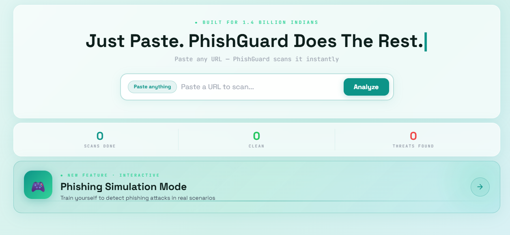

<!-- Animated Hero Banner -->
<div align="center">
  
</div>



<!-- Typing Tagline -->
<div align="center">
  <a href="https://phishguard-8qm0.onrender.com/">
    
  </a>
</div>

<br/>

<!-- Live Status & Repo Badges -->
<div align="center">
  <a href="https://phishguard-8qm0.onrender.com/" target="_blank">
    <src="https://img.shields.io/website?url=https%3A%2F%2Fphishguard-8qm0.onrender.com%2F&up_message=ONLINE&down_message=WAKING%20UP&label=LIVE%20DEMO&style=for-the-badge&color=10B981" alt="Live Demo Status" />
  </a>
  <a href="https://github.com/PushkarEz/PhishGuard/stargazers">
    
  </a>
  <a href="https://github.com/PushkarEz/PhishGuard/network/members">
    
  </a>
  
</div>

<br/>

<!-- Quick Action Navigation -->
<div align="center">
  <a href="https://phishguard-8qm0.onrender.com/"><b>Launch Live App</b></a>
  &nbsp;&bull;&nbsp;
  <a href="#-how-it-works"><b>How It Works</b></a>
  &nbsp;&bull;&nbsp;
  <a href="#-run-locally"><b>Run Locally</b></a>
  &nbsp;&bull;&nbsp;
  <a href="https://pushkarez.vercel.app/"><b>Portfolio</b></a>
</div>

---

## Overview

**PhishGuard** is a web-based phishing detection tool designed to analyze suspicious URLs and surface risk indicators before users click.

> **Live Deployment:** [https://phishguard-8qm0.onrender.com/](https://phishguard-8qm0.onrender.com/)  
> *(Hosted on Render Free Tier — first load may take ~30 seconds if the instance is asleep.)*

---

## Interactive Walkthrough

<details open>
<summary><b>1. Core Capabilities</b> (click to collapse)</summary>
<br/>

| Feature | What It Does |
| :--- | :--- |
| **Instant URL Scan** | Submit any URL to check phishing likelihood & risk status |
| **Signal Inspection** | Flags suspicious URL patterns, domain anomalies, and phishing cues |
| **Clean Verdict UI** | Clear Safe / Suspicious / Phishing feedback without clutter |
| **Cloud Deployed** | Publicly accessible web app hosted on Render |

</details>

<details>
<summary><b>2. Tech Stack</b> (click to expand & customize to your exact libs)</summary>
<br/>

<!-- Update badges below if you used Flask/FastAPI/React/ML libs -->
- **Backend:** Python (`app.py` / FastAPI or Flask)
- **Detection Logic:** URL Feature Extraction & Classification Model
- **Frontend:** HTML / CSS / JavaScript
- **Hosting:** Render

</details>

<details id="-how-it-works">
<summary><b>3. How It Works</b> (click to expand)</summary>
<br/>

```text
User Submits URL ──▶ Feature Extraction (Length, Symbols, Domain, HTTPS, Keywords)
                          │
                          ▼
               Classification / Risk Scoring
                          │
                          ▼
            Clear Verdict + Risk Breakdown Shown in UI
